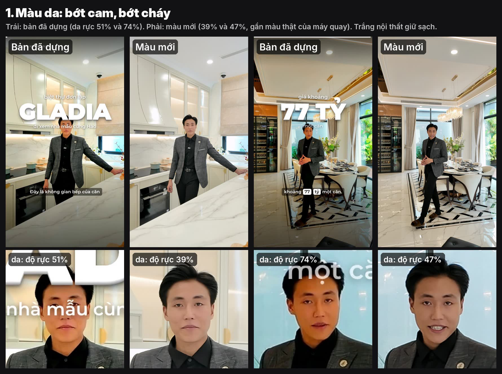
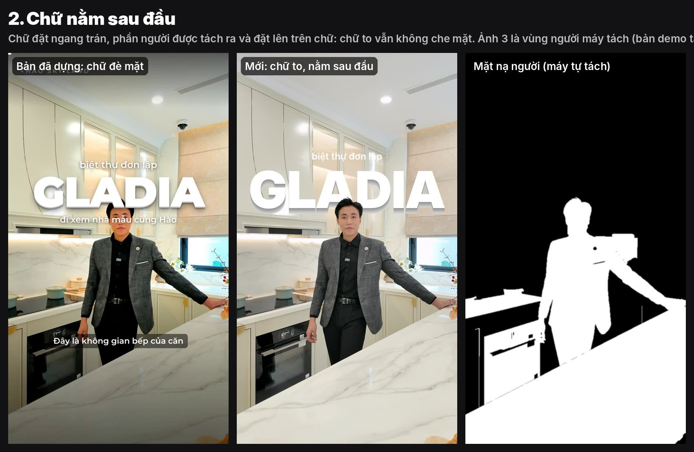
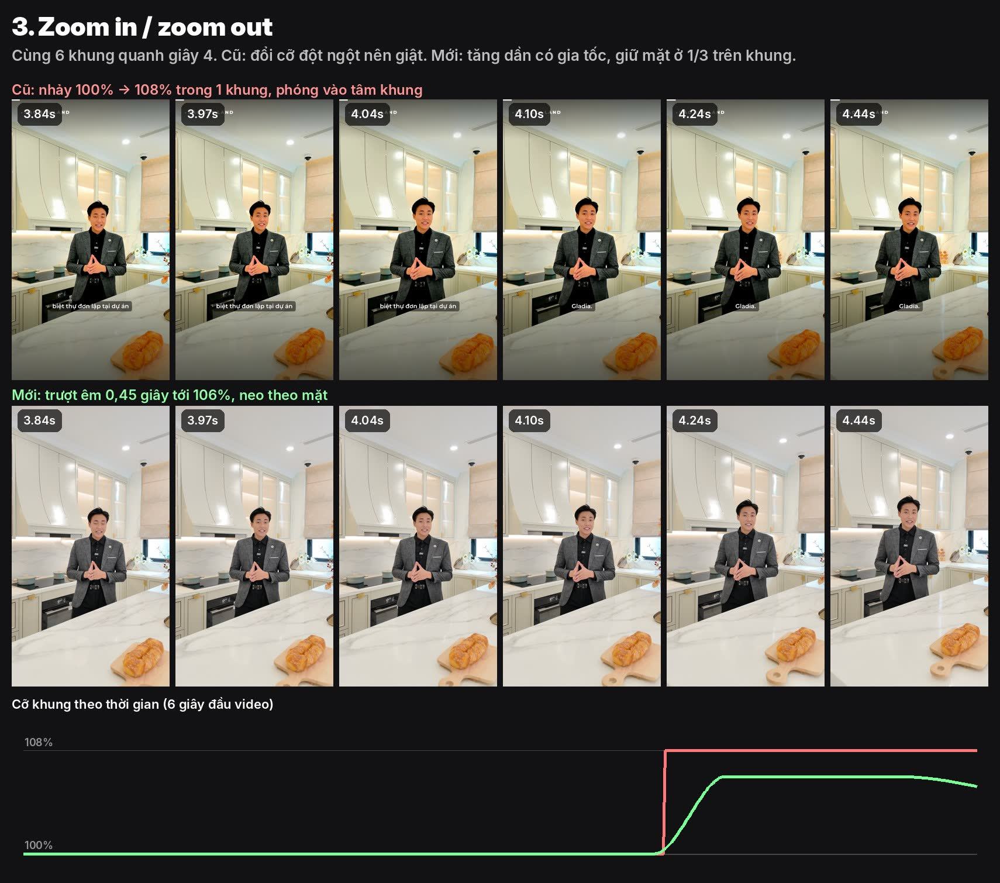

# Ghi nhớ nghiệm thu: lỗi đã gặp và cách dựng đúng

Mỗi lần Hào nghiệm thu một video, ghi lại ở đây: Hào thấy gì, nguyên nhân, cách sửa, đã đưa vào phần mềm chưa. **Claude đọc file này trước khi dựng video mới.**

---

## Lần 1: video Gladia (13/11/2026)

Dự án `projects/zz-2026-11-13_tiktok_nghiem-thu` (video thô 77 giây, Hào đi giới thiệu nhà mẫu, quay một mạch bằng DJI, 1728×3072, 60 khung/giây). Hào nhận xét: "tạm ổn", chưa cần dựng lại; chỉ xem khung demo cho 3 điểm sau.

### 1. Màu da bị cam, bị cháy

| | Độ rực của da (vùng giữa mặt) |
|---|---|
| Video gốc của máy quay | 38–45% |
| Bản đã dựng | **51–74%** (cam hẳn, gần cháy) |
| Màu mới (demo) | 39–47% |

**Nguyên nhân (đã đo):** hai bước cùng đẩy màu lên:
1. `mau.tu_can` thấy cảnh nội thất toàn màu trắng (ít màu) nên **tăng độ rực tới 1,3 lần**. Trong cảnh trắng, thứ có màu duy nhất là da người, nên da bị đẩy mạnh nhất.
2. Phong cách `edit-phim` dùng màu `tuoi-dam` (+8% độ rực, +18% vibrance) cộng thêm lần nữa.

**Cách dựng đúng:**
- Cảnh có người nói trong nội thất trắng: **không tăng độ rực khi tự cân** (tối đa 1,05).
- Thêm bước **giữ màu da**: giảm 14% độ rực riêng vùng đỏ/vàng, ngả lạnh nhẹ (6800K, trộn 35%):
  `eq=contrast=1.05:saturation=1.04,huesaturation=colors=r+y:saturation=-0.14,colortemperature=temperature=6800:mix=0.35`
- Kiểm tra bằng số, không bằng mắt: da (vùng giữa mặt) nên ở **35–50% độ rực, sắc độ 14–20°**. Vượt 55% là cam.
- Trắng của tủ, tường phải vẫn trắng sạch (đã kiểm trong demo).

**Trạng thái (13/11):** đã làm. `mau.tu_can` không tăng rực quá 5%. Bộ đạo diễn màu `scripts/chinh_mau.py` (`CHINH-MAU.md`) có bước giữ da: thử với video này, da giữ 38→38%, kể cả khi lấy màu từ ảnh mẫu tông cam (38→40%). Chưa dựng lại video Gladia.

### 2. Chữ che mặt: phải đặt chữ sau đầu

**Hào nhận xét:** chữ lớn (GLADIA, 77 TỶ…) đè lên mặt. Dân edit chuyên nghiệp đặt chữ **sau đầu**: chữ to vẫn nổi mà mặt người nói không bị che.

**Cách dựng đúng:**
- Đặt chữ lớn **ngang trán hoặc ngang tai**, khoảng 1/3 trên của khung (không đặt giữa khung).
- Tách người ra khỏi nền (mặt nạ người), rồi xếp lớp theo thứ tự: **video → chữ → người**. Chữ bị đầu và vai che một phần là đúng ý đồ: tạo chiều sâu.
- Nhãn nhỏ phía trên ("biệt thự đơn lập") đặt cao hơn đỉnh đầu, không để đầu che.
- Chữ có số liệu (giá, diện tích) **không được** để đầu che mất chữ số. Nếu đầu nằm giữa khung thì dời số sang hai bên hoặc lên cao.
- Khi người đi lại (không đứng yên) thì chỉ dùng chữ sau đầu ở cảnh đứng nói; cảnh đi bộ để chữ ở trên cao như cũ.

**Trạng thái (13/11, Hào yêu cầu làm):** đã làm cho cả video. Thêm `"sau_dau": true` vào khối chữ (vd. `title3d`). Bộ dựng:
1. dựng nền ra file;
2. tách người từng khung bằng **MODNet** (giấy phép Apache-2.0, 25 MB, chạy bằng onnxruntime có sẵn, tự tải về `video-studio/models/` lần đầu), chỉ ở khoảng có chữ, làm mượt mép theo thời gian;
3. ghép nền → chữ → người.

**Tự đặt chữ ngang đầu:** bộ dựng tìm đỉnh đầu ở giây thứ 0,8 của mỗi chữ (tính cả zoom), đặt khối chữ để khoảng 30% dưới của chữ lớn nằm sau đầu. Đặt tay thì ghi `top_px`. Dòng nhỏ dưới chữ lớn (`sub`) thường bị đầu che, nên chữ sau đầu nên để thông tin chính ở chữ lớn và nhãn trên.
Mã: `scripts/tach_nguoi.py`, `dung.py`. Tốc độ trên cloud: khoảng 0,3 giây mỗi khung hình. Khung xem trước của app chưa hiện hiệu ứng này, phải Dựng nháp mới thấy. Vật ở tiền cảnh (mặt bàn đá) cũng được tính là "người", nên chữ đặt thấp sẽ bị che.

### 3. Zoom in / zoom out chưa đẹp

**Nguyên nhân:** master cut tự thêm "phóng xen kẽ" kiểu nhảy cỡ: **100% → 108% trong đúng 1 khung hình**, phóng vào **tâm khung** (không theo mặt), giữ nguyên vài giây rồi nhảy về. Người xem thấy như máy giật, và có lúc đầu bị đẩy lệch.

**Cách dựng đúng:**
- **Đẩy vào êm** (push-in) 0,4–0,6 giây có gia tốc (chậm → nhanh → chậm), tối đa **104–106%**, không phải 108%.
- **Neo theo mặt**: mặt nằm ở khoảng 1/3 trên của khung khi phóng, không phóng vào tâm.
- Chỉ phóng khi **có lý do**: câu chốt, con số, chữ lớn hiện ra. Không rải đều mỗi 4 giây.
- Phóng xong thì **lùi ra rất chậm** (1–2 giây) hoặc giữ đến chỗ cắt tiếp theo. Không nhảy về 100% giữa câu.
- Cắt nhảy giữa hai mẩu nói cùng góc máy: đổi cỡ 100% ↔ 104% **ngay tại chỗ cắt** thì được (che vết cắt). Không đổi cỡ giữa một mẩu.
- Video đi bộ (máy đang di chuyển) thì hạn chế zoom, vì chuyển động của máy đã đủ.

**Trạng thái:** mới là demo trên ảnh và biểu đồ. **Chưa sửa `master_cut.py` (nhịp phóng) và `dung.py` (zoompan đang đổi cỡ bậc thang, phóng vào tâm).** Cần kiểm thêm: ở giây 4,04 bản đã dựng gần như không thấy đổi cỡ, nên có thể mốc zoom trong `dung.py` đang lệch giờ so với mốc trong timeline.

### Những điều khác của lần này (đã sửa trong code)
- Cắt khoảng lặng từng bỏ mất 13 giây mở đầu vì một câu nói lặp lại. Đã sửa: chỉ bỏ lần nói trước gần nhất, và không bỏ đoạn có câu đã nói trọn (`master_cut.py`, có bài kiểm thử).
- Chữ dài ("PHÒNG KHÁCH") tràn khung. Đã sửa: chữ dài tự thu nhỏ (`lop_chu.py`).
- Phụ đề tự nhận dạng còn sai từ chuyên ngành ("chủ tư", "sông vườn"). Lần sau nhận dạng kèm danh sách từ của dự án (Gladia, chủ đầu tư, sân vườn, bàn giao…) thì đúng hơn hẳn.

---

## Việc cần làm để áp dụng (theo thứ tự)
1. ~~Màu da~~: xong 13/11 (`chinh_mau.py`, chặn tăng rực trong `tu_can`).
2. Zoom êm, neo theo mặt, phóng theo chữ lớn: sửa `dung.py` + `master_cut.py`.
3. ~~Chữ sau đầu~~: xong 13/11 (`sau_dau`, MODNet).

---

## Lần 2: video Gladia, chữ sau đầu + âm theo nhịp chữ (13/11/2026)
Hào: "ưng hiệu ứng chữ lúc ban đầu hơn (chữ trắng nổi 3D lao vào), nhưng vẫn giữ chữ phía sau đầu; kết hợp bộ âm cho nhịp chữ như chuyên gia âm thanh".

### Luật âm theo nhịp chữ (mẫu có `nhip_chu`, mã `ap_mau.py`)
| Lớp | Thời điểm | Âm mặc định | Âm lượng | Luật |
|---|---|---|---|---|
| Vào | **đỉnh** tiếng vút trùng khung chữ chạm | `whoosh_nhanh_01` | 0,45 | lọc trầm 150 Hz (không lấn giọng); hai tiếng vút cách nhau ≥ 0,4 s |
| Chạm | khung chữ dừng | `chu_swish-pop_01` (theo mẫu) | 0,55 | có sẵn từ trước |
| Trầm | chỉ chữ **đầu tiên** và chữ có **tiền, %** | `impact_tram_01` | 0,55 | không đặt cho mọi chữ: nghe nhàm, mất sức nặng |
| Lấp lánh | chữ có số | `ting_lap-lanh_01` | 0,3 | thay tiếng ting số liệu cũ (hai tiếng ting chồng nhau nghe rối) |
| Ra | lúc chữ tan | `whoosh_quat_01` | 0,22 | bỏ nếu chữ sau tới trong 0,6 s; lọc trầm 200 Hz |
| Chung | | | | cao độ luân phiên 100% / 96% / 104% để tai không nhận ra một tiếng lặp lại; cả bài chuẩn −14 LUFS sau khi trộn |
